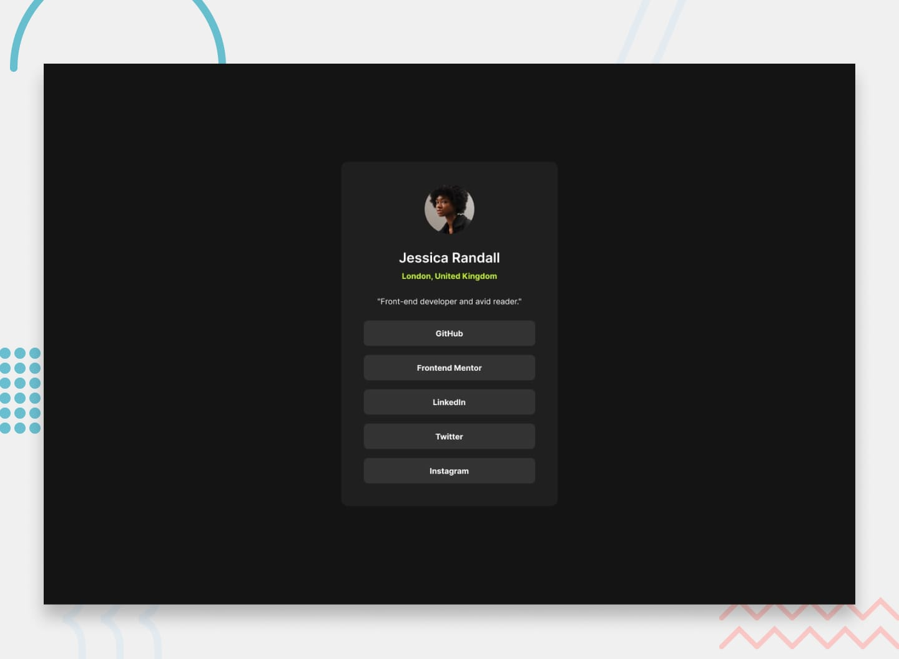

# Frontend Mentor - Social links profile solution

This is my solution to the [Social links profile challenge on Frontend Mentor](https://www.frontendmentor.io/challenges/social-links-profile-UG32l9m6dQ). Frontend Mentor challenges help developers improve their coding skills by building realistic projects.

## Table of contents

- [Overview](#overview)
  - [The challenge](#the-challenge)
  - [Screenshot](#screenshot)
  - [Links](#links)
- [My process](#my-process)
  - [Built with](#built-with)
  - [What I learned](#what-i-learned)
  - [Continued development](#continued-development)
  - [Useful resources](#useful-resources)
- [Author](#author)
- [Acknowledgments](#acknowledgments)

## Overview

### The challenge

Users should be able to:

- View an adaptable social profile card
- See hover and focus states for all interactive elements

### Screenshot



### Links

- Solution repository: [GitHub](https://github.com/SGcoder120/social-links-profile-main)
- Live site: [Add live site URL here](https://example.com)

## My process

### Built with

- Semantic HTML5
- CSS
- Flexbox
- CSS custom properties
- Responsive design principles

### What I learned

This project introduced me to building a small profile component from a visual design. I practiced:

- Structuring profile content with HTML
- Using Flexbox to arrange elements vertically
- Centering content on the page
- Reading a style guide and applying a color palette
- Working with local image and font assets

For example, I used a Flexbox container to control the layout direction:

```css
.container {
  display: flex;
  flex-direction: column;
}
```

### Continued development

In future projects, I want to continue improving:

- Responsive layouts across mobile and desktop sizes
- The card's spacing, sizing, and typography
- Accessible keyboard focus states
- Semantic HTML, including the use of links instead of buttons for external destinations
- Testing layouts at different screen widths

### Useful resources

- [Frontend Mentor](https://www.frontendmentor.io) - A collection of practical front-end challenges
- [MDN Flexbox documentation](https://developer.mozilla.org/en-US/docs/Learn_web_development/Core/CSS_layout/Flexbox) - Helpful explanations and examples for learning Flexbox
- [MDN HTML and CSS guides](https://developer.mozilla.org/en-US/docs/Web) - Clear reference material for HTML and CSS concepts

## Author

- GitHub - [SGcoder120](https://github.com/SGcoder120)
- Frontend Mentor - [Add your Frontend Mentor profile](https://www.frontendmentor.io/)

## Acknowledgments

Thanks to Frontend Mentor for providing the design and project brief.
